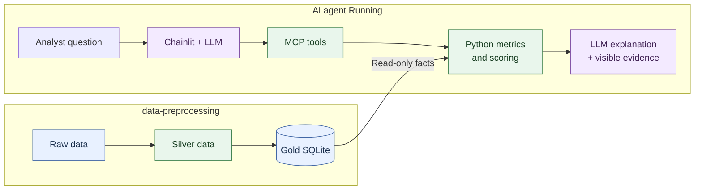

# Airport Investment Intelligence Agent

Start with the [Design and architecture guide](design.md) for a visual overview of the data pipeline, analysis, and chat flow.

A conversational research assistant that helps analysts explore US airports and identify candidates for modernization or terminal expansion. Ask questions in plain English, compare airports, and follow up on the results in a Chainlit chat.

The project combines historical traffic, flight reliability, and FAA forecasts with deterministic Python metrics. Gemini chooses the appropriate tools and explains their evidence. The goal is to make an initial investment screening transparent and repeatable: the results help decide which airports deserve further investigation, rather than estimate financial returns or prove that a terminal needs expansion.

## What you can do

- Compare historical passenger growth across airports, states, or supported US regions.
- Examine operational pressure through arrival disruptions, cancellations, diversions, and delays.
- Measure the share of scheduled outbound passenger departures flying at least 2,000 miles.
- Compare passenger growth with offered-seat growth and inspect forecast context.
- Rank eligible terminal-expansion candidates using a defined screening model.
- Ask follow-up questions while retaining the current conversation's context.

Example questions:

> Which airports in New England are strong candidates for terminal expansion?
>
> Compare operational pressure at LAX and John Wayne Airport in 2025.
>
> What percentage of Anchorage's outbound flights are long haul?
>
> Which Texas airports have passenger traffic growing faster than offered seats?

Answers should identify the actual periods, source coverage, assumptions, and missing evidence. Broader questions about unmet demand, investment profitability, or the causes of congestion may exceed the available tools.

## How it works



The six MCP tools are `lookup_airports`, `traffic_growth`, `airport_operational_pressure`, `outbound_long_haul_share`, `demand_capacity_pressure`, and `terminal_expansion_opportunity`. Chainlit starts the MCP server automatically as a local subprocess; no separate server or database service is needed.

The main technologies are **Python 3.11, pandas, SQLite, FastMCP, LangChain, Gemini, and Chainlit**. Quantitative calculations and ranking rules live in Python. The model handles tool selection and explanation.

## Run locally

The pre-publication review found known vulnerabilities in the current Chainlit
and FastMCP pins. Dependency remediation and full runtime validation are still
pending; see [the audit findings and proposed actions](PUBLICATION_REVIEW.md).

### 1. Prepare your environment

Use Python 3.11 and run these PowerShell commands from the repository root:

```powershell
py -3.11 -m venv .venv
Copy-Item .env.example .env
```

If you already have a `.env`, edit it instead of copying over it. Set your Gemini API key in that file:

```dotenv
GEMINI_API_KEY=your_api_key_here
LLM_MODEL=gemini-3.8-flash
```

Example configuration (matches the code default): `LLM_MODEL=gemini-3.8-flash`. `LLM_MODEL` is optional; it overrides the default in `app/ui/agent.py`. If that model is unavailable to your account, choose another available Gemini model. An internet connection is needed to install dependencies and call Gemini; chat requests use your Gemini account quota. Keep `.env` local; it is ignored by Git.

### 2. Make the prepared database available

The assistant requires this file:

```text
data/gold/airport_gold.db
```

**This public project includes the prepared Gold database at the path above.** Raw source snapshots, cleaned Silver CSVs, and mapping audit files are not included. You can use the chat immediately after configuring your environment, without running ETL. Rebuilding the database requires obtaining those separate inputs as described below. Starting the application does not download sources or run ETL.

Check that the file exists:

```powershell
Test-Path data/gold/airport_gold.db
```

The result must be `True` before using the airport analysis tools.

### 3. Start the chat

```powershell
.\.venv\Scripts\python.exe run_app.py
```

The launcher installs the pinned dependencies from `requirements.txt`, sets `PYTHONPATH`, and starts Chainlit with file watching. Open **http://localhost:8000**, then ask an airport question. Stop the application with `Ctrl+C`.

For subsequent runs, you can skip dependency installation:

```powershell
$env:PYTHONPATH = "$PWD/app"
.\.venv\Scripts\python.exe -m chainlit run app/ui/app.py --host 127.0.0.1 -w
```

Chat history lasts for the current session. Login and saved conversations are not configured. The documented commands bind to loopback only; the app is intended for local use. Public hosting requires authentication and abuse controls. Questions, conversation history, and selected tool results are sent to Google Gemini; avoid confidential or personal input. Optional evaluation output contains prompts and answers and stays local through `.gitignore`.

The environment template and code use the same model example; model availability depends on your Google account.

### Common startup issues

| Symptom | What to check |
|---|---|
| Airport tools cannot read data | Confirm `data/gold/airport_gold.db` exists and is a prepared Gold database. |
| Missing API key or authentication error | Set `GEMINI_API_KEY` in `.env` and restart the app. |
| Model not found | Set `LLM_MODEL` to a Gemini model available to your account and restart. |
| Quota or rate-limit error | Check the Gemini account's quota or retry later. |
| `No module named analysis`, `ui`, or `etl` | Run from the repository root using the launcher, or set `PYTHONPATH` as shown above. |

## Project structure

```text
.
├── app/
│   ├── ui/
│   │   ├── app.py                  # Chat lifecycle, MCP connection, history, errors
│   │   └── agent.py                # Gemini agent, instructions, tool execution limits
│   ├── analysis/
│   │   ├── service.py              # Selection, periods, eligibility, analysis orchestration
│   │   ├── metrics.py              # Deterministic formulas and scoring
│   │   ├── models.py               # Validated request and result models
│   │   ├── evidence.py             # Definitions, source context, and limitations
│   │   └── dao_get_gold_data.py    # Read-only SQLite queries
│   ├── etl/
│   │   ├── initializer.py          # Task setup and submission
│   │   ├── runner.py               # Shared execution, staging, and publication
│   │   └── tasks/                 # t1 activity -> t2 performance -> t3 airports
│   │                              # -> t4 outlook -> t5 Gold database
│   └── mcp_server.py              # Six airport tools exposed over stdio
├── data/
│   └── gold/                      # Included prepared airport_gold.db
├── tests/
│   ├── analysis/                  # Formulas, evidence, eligibility, database reads
│   ├── etl/                       # Transformations and pipeline behavior
│   ├── evaluation/                # Runtime validation and optional live evaluation
│   ├── test_app.py                # Chat and agent behavior
│   └── test_mcp_server.py          # Tool wrappers and MCP integration
├── docs/
│   ├── 01-overview/               # Assignment, technical design, evaluation questions
│   ├── 02-data-preparation/       # Source selection and cleaning decisions
│   ├── 03-data-modeling/          # Silver/Gold structure and airport identity
│   ├── 04-analysis/               # Metrics, screening rules, interpretation
│   ├── 05-chat-and-mcp/           # Agent flow, tools, and failure handling
│   └── 06-testing-and-evaluation/ # Test strategy, findings, and limitations
├── .env.example                   # Environment variable template
├── chainlit.md                    # Chat welcome content
├── requirements.txt               # Pinned application dependencies
├── requirements-dev.txt           # Development and validation dependencies
└── run_app.py                     # Local application launcher
```

To change a metric, start in `app/analysis/`. To add a data transformation, use `app/etl/tasks/` and the shared runner. Tool interfaces belong in `app/mcp_server.py`; chat behavior belongs in `app/ui/`.


## How I approached the task

I split the solution into stages so each answer could be traced back to source data and explicit calculations:

1. **Define the questions and evidence needed.** Translate the assignment into airport comparisons, growth indicators, and a repeatable expansion-screening method. Preserve the distinction between a useful investment signal and evidence of profitability.
2. **Prepare reusable public datasets.** Use BTS T-100 for traffic and offered seats, BTS Reporting Carrier On-Time Performance for flight outcomes, and FAA Terminal Area Forecast for annual boardings and operations. Keep source snapshots separate from cleaned outputs so chat does not depend on live data retrieval.
3. **Reconcile airport identities and model the data.** Map airport references to canonical physical airports, retain a mapping audit, and aggregate datasets at compatible grains before analysis. Keep calendar-year traffic separate from fiscal-year forecasts, and preserve missing measurements separately from valid zeros.
4. **Implement the analysis before adding the model.** Calculate metrics, coverage, eligibility, and scores in Python. The expansion screen combines national-cohort percentile components: 40% historical passenger CAGR, 40% forecast boarding additions, and 20% arrival disruption. Return the component contributions and exclusion reasons with the score.
5. **Expose the analysis through tools and chat.** Wrap the service in FastMCP tools, then let Gemini select tools and explain their outputs through Chainlit. Retain conversation context and make tool evidence inspectable in the interface.
6. **Validate calculations and integration separately.** Test data transformations and metrics, mock model responses for chat tests, and retain runtime checks and optional live evaluation results for examining answer quality.

The main tradeoff is to favor reproducible analysis over live ingestion during chat. Passenger/seat ratios and disruptions are screening indicators: they do not directly measure unmet demand or establish a terminal bottleneck. The score is a project-defined model, not an FAA or BTS investment recommendation.

## Data preparation and rebuilding

The application reads Gold only. Rebuilding data is a separate workflow, with tasks run in this dependency order:

| Task | Output |
|---|---|
| `t1_flight_activity` | `data/silver/flight_activity.csv` |
| `t2_flight_performance` | Monthly CSVs in `data/silver/flight_performance/` |
| `t3_airports` | `data/silver/airports.csv` and `data/metadata/airports_mapping_audit.csv` |
| `t4_airport_outlook` | `data/silver/airport_outlook.csv` |
| `t5_airport_gold` | `data/gold/airport_gold.db` |

If the required Silver files and mapping audit are already available and dependencies are installed, build Gold with:

```powershell
$env:PYTHONPATH = "$PWD/app"
.\.venv\Scripts\python.exe -m etl.tasks.t5_airport_gold
```

The builder refuses to overwrite an existing database. To make a separate build, pass `--output data/gold/airport_gold_new.db`; the chat still reads `airport_gold.db` at its fixed path. Use `--help` to inspect the builder options. For source requirements and cleaning decisions, read the [data preparation guide](docs/02-data-preparation/data-preparation.md).

## Validation

Top-level dependencies are pinned; transitive dependencies are not locked. A clean Python 3.11 installation still needs verification before release. A wheel-only install during review could not resolve Chainlit's `literalai==0.1.201` dependency; ordinary pip may require a source build. See [publication review](PUBLICATION_REVIEW.md) for remaining checks.

Install development dependencies, then run tests and linting from the repository root:

```powershell
.\.venv\Scripts\python.exe -m pip install -r requirements-dev.txt
.\.venv\Scripts\python.exe -m pytest -q
.\.venv\Scripts\python.exe -m ruff check app tests run_app.py
```

The test suite uses temporary databases and mocked model responses without paid Gemini requests. To check the real local database, MCP subprocess, and Chainlit HTTP startup without calling Gemini:

```powershell
$env:PYTHONPATH = "$PWD/app"
.\.venv\Scripts\python.exe tests/evaluation/validate_runtime.py
```

Optional live evaluation calls Gemini and uses account quota:

```powershell
.\.venv\Scripts\python.exe tests/evaluation/evaluate_agent.py --runs 2 --output data/evaluations/new-run
```

The [test set](docs/01-overview/test-set.md) also includes questions beyond the current tool capabilities; live results require evidence review.

## Documentation guide

Start with [Design and architecture](design.md) for a visual overview of the data pipeline, analysis, and chat flow.

Follow the project from the original requirements through data preparation, analysis, and chat. Read the chapters in order for the full walkthrough, or jump to the topic you need. The [documentation index](docs/README.md) is also available as a standalone guide.

| Chapter | What you'll find |
|---|---|
| [1. Overview and technical design](docs/01-overview/tech-design.md) | Architecture, source choices, component responsibilities, and the screening approach. |
| [2. Data preparation](docs/02-data-preparation/data-preparation.md) | How source files are cleaned, airport identities are reconciled, and prepared datasets are published. |
| [3. Data modeling](docs/03-data-modeling/data-modeling.md) | Data layers, table grains, airport identities, and relationships in the Gold database. |
| [4. Deterministic analysis](docs/04-analysis/analysis.md) | Metric formulas, worked examples, airport eligibility, and ranking rules. |
| [5. Chat and MCP](docs/05-chat-and-mcp/chat-and-mcp.md) | How a question moves through the agent and tools, including follow-ups and error handling. |
| [6. Testing and evaluation](docs/06-testing-and-evaluation/testing-and-evaluation.md) | Test strategy, runtime checks, live-answer findings, and remaining coverage. |

For the original scope, see the [task definition](docs/01-overview/task-definition.md). For example questions and evaluation scenarios, see the [question catalog](docs/01-overview/test-set.md), which also includes capabilities beyond the current tools.

## License and data rights

Project code is covered by the existing [MIT license](LICENSE). Third-party datasets retain their own terms; the project license does not grant rights to upstream data. See [third-party sources and permissions](THIRD_PARTY_NOTICES.md) and the [pre-publication audit](PUBLICATION_REVIEW.md) for outstanding checks.
