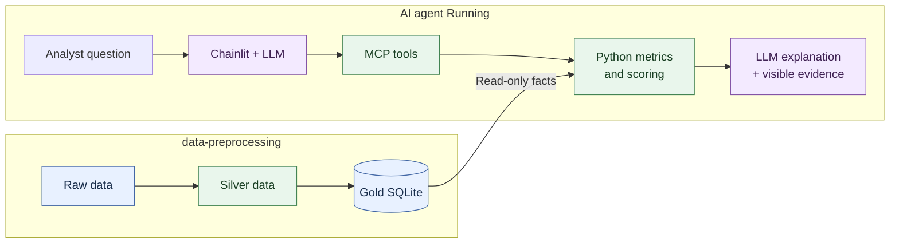
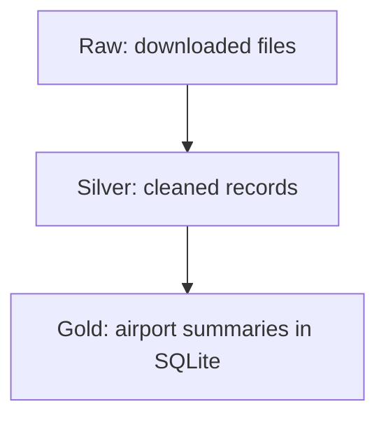
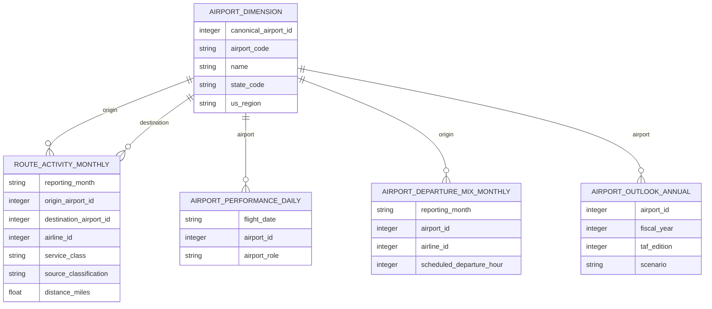
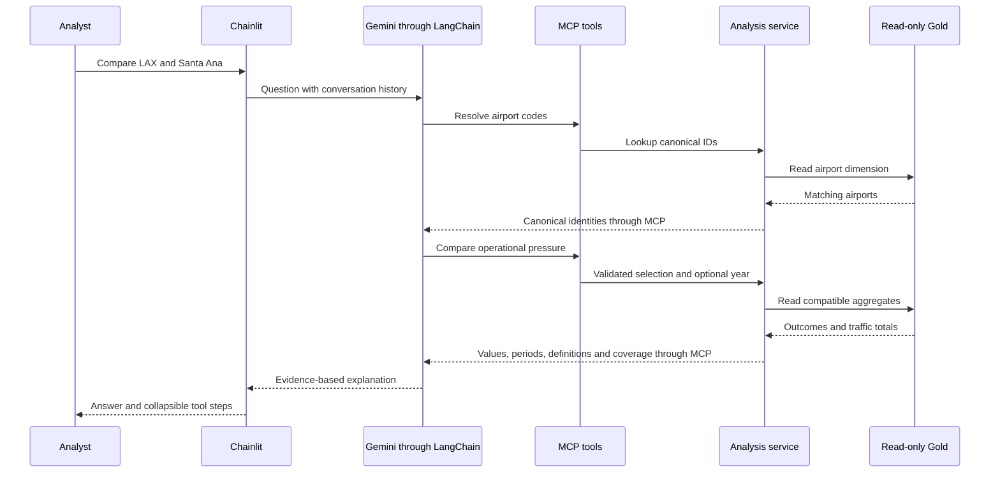

# Design and architecture

The Airport Investment Intelligence Agent helps analysts explore US airports and
shortlist candidates for modernization or terminal expansion. This summary follows
the project from source preparation through analysis, conversation and evaluation.



## 1. Overview and architecture

The system separates offline data preparation from interactive analysis. Public
aviation snapshots become a prepared database; analyst questions then trigger
bounded Python operations against that database. Gemini selects those operations
and explains their evidence through a Chainlit chat interface.

This separation keeps calculations reproducible across differently phrased
questions and avoids downloading or cleaning data during conversations. It trades
automatic freshness for controlled updates. The output is an initial screening:
construction costs, project cash flows and measured terminal capacity are outside
the available evidence, so a high rank identifies further research rather than
proving an investment case.

## 2. Data preparation

The chosen datasets below are taken from the
[data preparation document](docs/02-data-preparation/data-preparation.md#chosen-datasets).
Together they describe traffic, reliability, airport identity and future activity.

| Source | Why selected | Prepared output |
|---|---|---|
| [BTS T-100 Segment, All Carriers](https://www.transtats.bts.gov/Fields.asp?gnoyr_VQ=FMG) | Monthly traffic, seats, departures, distance and freight, including international and cargo activity | `flight_activity.csv` |
| [BTS Reporting Carrier On-Time Performance](https://transtats.bts.gov/TableInfo.asp?gnoyr_VQ=FGJ&QO_fu146_anzr=b0-gvzr&V0s1_b0yB=D) | Individual scheduled-flight reliability and reported delay causes | Twelve 2025 monthly performance partitions |
| [BTS airport-ID names](https://www.transtats.bts.gov/Download_Lookup.asp?Y11x72=Y_NV42146_VQ), [OurAirports](https://ourairports.com/data/) and [FAA airport metadata](https://www.faa.gov/data_research/aviation/taf) | Official names and independent cross-source identity evidence | `airports.csv` and mapping audit |
| [FAA TAF enplanements and operations](https://www.faa.gov/data_research/aviation/taf) | Historical and forecast annual airport activity | `airport_outlook.csv`, configured edition 2025 |

The pandas ETL pipeline validates source records, detects duplicates, preserves
missing measurements and publishes cleaned Silver CSVs. Large flight-performance
files are processed in chunks to limit memory use. Airport reconciliation uses
BTS, FAA and OurAirports reference evidence, recording accepted matches and
unresolved identities in a mapping audit.

Outputs include traffic, monthly flight-performance partitions, airport references
and annual outlook data. Missing delays remain unknown rather than becoming
on-time flights. These checks protect interpretation, although completeness of
configured source files does not imply coverage of every airline.

## 3. Data modeling

We organize the data so the assistant can compare airports without counting the
same activity twice. The cleaned files become a SQLite database containing airport
details, traffic totals, flight outcomes and forecasts.

### From source files to the analysis database



| Layer | What it holds |
|---|---|
| Raw | Original BTS, FAA and airport reference files |
| Silver | Cleaned traffic, flight outcomes, airport details and annual outlook |
| Gold | Airport summaries and supporting source information used by the assistant |

A separate airport mapping file records which BTS and FAA identifiers refer to the
same airport.

### Gold table relationships

Verified airport aliases resolve to one canonical physical airport, preventing
duplicate ranking entries. The airport dimension connects monthly route activity,
daily flight performance, monthly departure mix and annual outlook records.



The diagram shows logical relationships and key dimensions, rather than every
column or enforced SQLite foreign keys. The separate `analysis_evidence` table
records source completeness and reporting context.

Traffic, flight outcomes and forecasts are summarized independently before
comparison. Joining monthly traffic directly to individual flights would repeat
passenger totals. Gold stores compatible counts and totals so ratios can be
calculated after aggregation, with measurement coverage reported alongside them.

Calendar years, FAA fiscal years, forecast editions and scenarios remain explicit.
SQLite supports simple local deployment and read-only analysis without another
service. Aggregation accelerates repeated questions while limiting which detailed
comparisons can later be reconstructed. Updating evidence requires a separate build.

## 4. Metrics and scoring

### Historical passenger growth

Measures observed growth in scheduled outbound passengers. CAGR makes different
comparison periods comparable. `P0` and `P1` are baseline and endpoint passengers;
`n` is elapsed calendar years.

```text
passenger_change = P1 - P0
growth_pct = 100 * (P1 / P0 - 1)
cagr_pct = 100 * ((P1 / P0) ** (1 / n) - 1)
```

### Arrival operational pressure

Compares reliability across airports of different sizes. Disrupted arrivals are
cancelled, diverted or completed at least 15 minutes late, counted once;
classifiable arrivals have known outcomes.

```text
arrival_disruption_pct = 100 * disrupted_arrivals / classifiable_arrivals
```

### Outbound long-haul share

Describes service mix, weighted by scheduled passenger departures rather than
route counts. Only departures with valid positive distance enter the denominator.

```text
long_haul_share_pct = 100 * departures_at_least_2000_miles / distance_eligible_departures
```

### Passenger-versus-seat growth

Identifies whether passenger activity outpaces offered seating. `P0/P1` and
`S0/S1` are passengers and seats from paired eligible records at each endpoint.
The gap is in percentage points; offered seats do not measure terminal capacity.

```text
passenger_growth_pct = 100 * (P1 / P0 - 1)
seat_growth_pct = 100 * (S1 / S0 - 1)
growth_gap_pp = passenger_growth_pct - seat_growth_pct
passenger_seat_ratio_pct = 100 * passengers / seats
```

### Expansion screening

Combines growth momentum, forecast scale and operational pressure. `H`, `F` and
`O` are national percentiles of passenger CAGR, five-fiscal-year additions in
annual boardings, and arrival disruption. Percentiles use the same eligible US
cohort before geographic filtering.

```text
forecast_additions = endpoint_annual_boardings - baseline_annual_boardings
percentile = 100 * (L + (E - 1) / 2) / (N - 1)
score = 0.40 * H + 0.40 * F + 0.20 * O
```

`L` counts lower values, `E` equal values and `N` eligible airports; a singleton
receives percentile 50. Weights are project policy: scores support investigation,
not financial-return estimates. Long-haul and passenger/seat metrics are separate
context. Zero denominators leave affected rates undefined.

## 5. Chat, tools and AI

Chainlit starts a local FastMCP subprocess for each chat. LangChain discovers its
six tool schemas: airport lookup and the five analyses. Gemini interprets requests,
resolves named airports through lookup, chooses tool arguments and explains results.
Python owns eligibility and arithmetic; FAA provides forecasts.

### MCP tools

| Tool | Description | Important boundary |
|---|---|---|
| `lookup_airports` | Resolve named airports or codes to canonical IDs | Supplied state/code/name filters combine with AND |
| `traffic_growth` | Compare historical outbound passengers | Actual calendar endpoints and coverage accompany values |
| `airport_operational_pressure` | Compare arrival disruption, delays, cancellations and traffic | Operational pressure does not establish terminal congestion |
| `outbound_long_haul_share` | Measure outbound departures at least 2,000 miles | Scheduled passenger service; departure-weighted |
| `demand_capacity_pressure` | Compare passenger/seat growth with operational and forecast context | Paired records; no direct unmet-demand estimate |
| `terminal_expansion_opportunity` | Screen requested candidates against national peers | Screening points and national ranks, not investment returns |

### Request flow



Tool arguments and evidence are visible in collapsible steps. Successful history
retains identities, periods and results for follow-ups, but lasts only for the
session. Five tool rounds, a final summary call, timeouts and explicit failure
evidence bound execution. Defined tools improve control and consistency while
restricting questions to implemented analyses; arbitrary SQL is not exposed.

## 6. Testing and evaluation

Automated tests check transformations, missingness, formulas, eligibility, national
ranking and chat behavior using constructed data and mocked model responses.
Separate runtime checks exercise the real database, MCP connection and UI startup.
Live evaluations compare Gemini explanations with tool evidence.

These layers distinguish numerical correctness from connection health and narrative
quality. Historical live runs exposed omitted coverage and unsupported explanations
even when tables were correct. Visible evidence and analyst review therefore remain
necessary; passing automated tests alone does not certify generated answers.

See the [documentation guide](docs/README.md) for detailed stage explanations.
