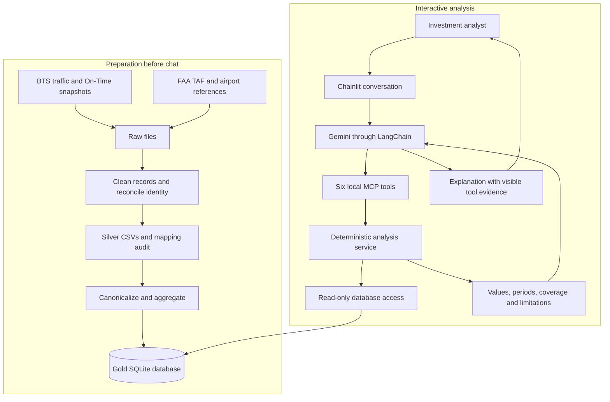
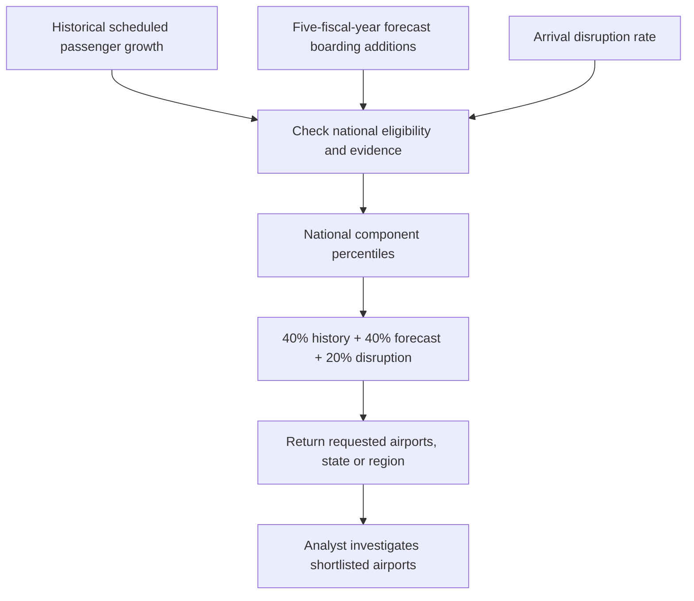

# Technical design

The Airport Investment Intelligence Agent helps analysts decide which US airports
deserve further investigation for modernization or terminal expansion. It combines
historical traffic, operational reliability and an official forecast into
reproducible comparisons. Gemini selects tools and explains evidence; Python owns
the calculations and ranking rules.

The assignment asks about investment opportunities. The delivered system provides
initial screening: its sources do not contain construction costs, terminal
capacity, project cash flows or directly measured unmet demand. A high score
identifies a candidate to investigate rather than a profitable project.

## End-to-end architecture

Preparation runs separately from conversations. Downloaded snapshots become cleaned
Silver datasets and then a local Gold SQLite database. Starting chat does not
download sources or rebuild data.

This separation makes numerical results independent of model phrasing. Updating
evidence requires deliberate preparation of a new database rather than silently
changing the data during a conversation.

## Why these sources

| Evidence | Source | Role | Interpretation boundary |
|---|---|---|---|
| Historical traffic and offered capacity | BTS T-100 Segment, All Carriers | Passengers, seats, departures, distance and freight | Offered airline seats are not terminal capacity or latent demand |
| Operational reliability | BTS Reporting Carrier On-Time Performance | Scheduled-flight outcomes and reported delay causes | Reporting-carrier coverage is narrower than all airport activity; attribution does not prove infrastructure causation |
| Future activity | FAA Terminal Area Forecast, configured edition 2025 | Historical and forecast annual boardings and operations | Forecasts are estimates; fiscal years require distinct labels |
| Shared airport identity | BTS names, OurAirports and FAA metadata | Reconcile identifiers and verified aliases | Matching codes alone do not establish physical identity |

T-100 supplies broad domestic/international segment coverage, including cargo.
On-Time adds flight outcomes that monthly traffic totals cannot provide. TAF adds
a forecast baseline without developing a forecasting model from the project's
short historical series.

## Responsibility boundaries

| Component | Responsibility | Reason |
|---|---|---|
| pandas and ETL runner | Parse snapshots, preserve missingness and publish cleaned outputs | Preparation is reusable across questions |
| SQLite Gold | Store canonical facts and additive aggregates | Repeated queries avoid rescanning raw files |
| Analysis service | Select periods, calculate metrics, apply eligibility and attach limitations | Numerical conclusions remain reproducible |
| FastMCP | Expose lookup and five bounded analyses over stdio | The model uses defined operations rather than arbitrary SQL |
| LangChain and Gemini | Select tools, retain context and explain evidence | Conversation can vary without redefining calculations |
| Chainlit | Manage sessions, show tool steps and present answers/errors | Analysts can inspect evidence behind answers |

One local MCP subprocess belongs to each chat and is reused across messages. No
separately managed database server or network MCP service is required.

## From evidence to screening

The reference population is the eligible national US cohort. A regional filter does
not recalculate normalization. Higher disruption increases the score without
claiming expansion would resolve that disruption. Missing mandatory inputs prevent
supported scoring; weights are not redistributed to hide missing evidence.

For example, a New England screening question returns component contributions,
actual periods, eligibility and exclusions. A question about unmet demand at SFO
can produce indirect indicators and limitations, but cannot produce a measured
lost-passenger total.

## Implemented scope and significant decisions

Silver preserves source detail; Gold aggregates facts independently. Joining
individual flights directly to monthly route records would multiply measurements.
Canonical identities prevent verified BTS aliases appearing as separate physical
airports in rankings.

Forecast edition, scenario and fiscal year remain separate dimensions. The current
model interprets source code `0` as historical and `1` as forecast, recording the
interpretation in evidence. Earlier designs left this unresolved. Forecast edition
must not be inferred from the baseline year.

The current conversation loop uses LangChain's Gemini integration and MCP adapters,
superseding earlier direct-SDK proposals. The delivered tools cover passenger
growth, arrival operational pressure, outbound long-haul share, passenger-versus-seat
growth and expansion screening. Broader question patterns such as peer matching,
seasonality, cargo-inclusive shares and route-removal scenarios are not exposed.

## Operational boundaries

Runtime requires an existing prepared Gold file. Model requests require account
access and quota. Credentials remain local. Conversations live in session memory;
login and persistent history are not configured. Timeouts and call limits bound a
turn, while tool failures remain visible as missing evidence.

Continue through [data preparation](../02-data-preparation/data-preparation.md),
[data modeling](../03-data-modeling/data-modeling.md),
[analysis](../04-analysis/analysis.md) and
[chat and MCP](../05-chat-and-mcp/chat-and-mcp.md).
Test methods, measured results and answer-quality findings are consolidated in
[testing and evaluation](../06-testing-and-evaluation/testing-and-evaluation.md).
