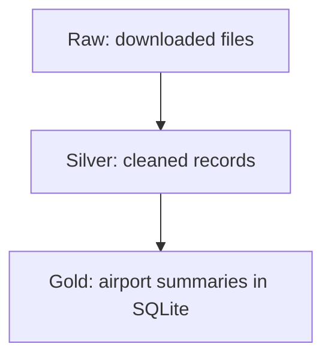
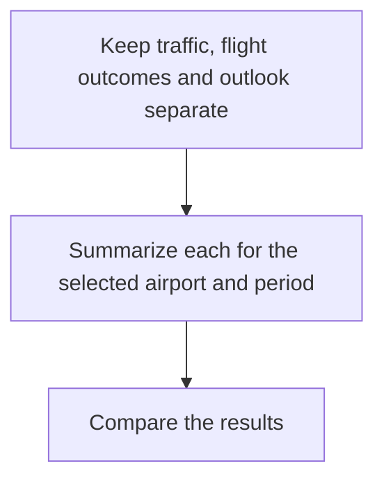
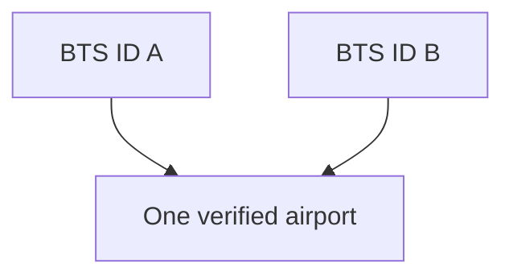
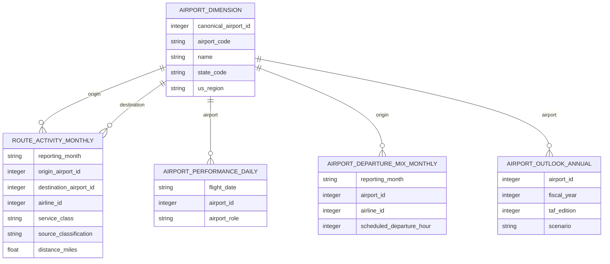
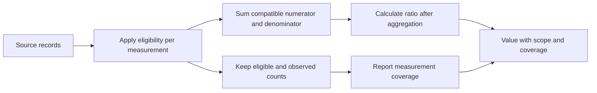
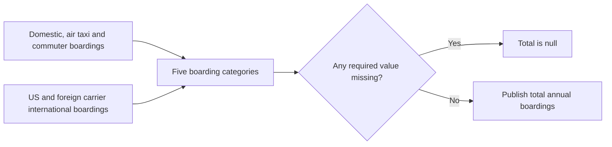
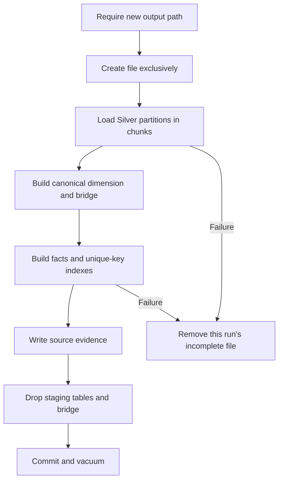

# Data modeling

We organize the data so the assistant can compare airports without counting the
same activity twice. The cleaned files become a SQLite database containing airport
details, traffic totals, flight outcomes and forecasts.

## From source files to the analysis database

| Layer | What it holds |
|---|---|
| Raw | Original BTS, FAA and airport reference files |
| Silver | Cleaned traffic, flight outcomes, airport details and annual outlook |
| Gold | Airport summaries and supporting source information used by the assistant |

A separate airport mapping file records which BTS and FAA identifiers refer to the
same airport.

## Summarize each dataset separately

The datasets describe activity at different levels:

- T-100: monthly traffic for a route, airline and service breakdown.
- On-Time: the outcome of one scheduled flight.
- TAF: annual airport activity for a publication edition and scenario.

Joining these records directly can repeat totals. For example, attaching one
monthly passenger total to 100 flight records and then summing it would count
that total 100 times.

Traffic and flight outcomes use calendar years; FAA outlook uses fiscal years.
Answers keep those periods clearly labeled.

## Count each physical airport once

One airport can have multiple verified BTS IDs. Gold groups these under one shared
ID, called the canonical airport ID, so the airport appears once in comparisons
and rankings.

The mapping file supplies these verified matches. Gold applies them to traffic,
flight outcomes and outlook records, and removes duplicate copies of a shared FAA
forecast. Routes whose endpoints resolve to the same airport are omitted.

US airports are also assigned to supported regions using explicit state lists:
New England, Middle Atlantic, Midwest, South and West. Airports outside these
lists have no assigned region.

## Published Gold tables

This diagram shows logical relationships and key dimensions, not every column or
a claim of enforced SQLite foreign keys.

| Table | One row represents | Main measurements |
|---|---|---|
| `airport_dimension` | One canonical physical airport | Representative code/name, FAA identifier, location, region and mapping status |
| `route_activity_monthly` | Month, canonical endpoints, airline, service class, source classification and distance | Traffic/freight totals, paired passengers/seats, distance-eligible departures, observation/flag counts |
| `airport_performance_daily` | Date, canonical airport and airport role | Scheduled flights, cancellations/diversions, observed delays, disruptions and cause populations |
| `airport_departure_mix_monthly` | Month, canonical origin, airline and scheduled departure hour | Scheduled flights, cancellations, observed departure delays and positive delay totals |
| `airport_outlook_annual` | Canonical airport, fiscal year, edition and scenario | Boarding categories, total/international boardings, operations and period classification |
| `analysis_evidence` | Dataset, year, edition and scenario | Source description, completeness, build ID, period type and category |

The daily performance table aggregates across airlines. Earlier designs proposed
retaining airline there; the current schema keeps airline/hour detail in the
monthly departure-mix table. That limits which comparisons can be reconstructed.
Retaining a grouping dimension does not automatically expose an analysis tool.

## Additive measurements and eligibility

Gold stores compatible numerators, denominators and observation counts rather than
only percentages. Two illustrative services with 50/100 and 810/900 passengers/seats
combine to `(50 + 810) / (100 + 900) = 86%`. Averaging their percentages gives 70%,
incorrectly assigning equal weight to services of very different sizes.

Paired totals require passenger service, nonnegative passengers, positive seats
and passengers no greater than seats. Both sums use the same rows. Distance
eligibility requires positive distance and nonnegative departures. Passenger,
seat, departure and freight totals separately admit nonnegative measurements.
Flags count questionable records without discarding every other field.

A scheduled flight contributes to origin and destination roles. Analysis must
select the role deliberately; adding both doubles the flight. Disruptions use
cancellation OR diversion OR a completed arrival at least 15 minutes late, counting
overlapping outcomes once.

Cause-minute totals use late completed arrivals with all five nonnegative cause
measurements present. Eligible, complete and partial attribution counts stay
separate. Positive arrival-delay minutes sum `max(delay, 0)` across observed
completed arrivals; early and on-time arrivals remain in that mean's denominator.

## Outlook totals and periods

Gold derives international boardings, total boardings and commercial operations
from Silver components. Arithmetic addition propagates missing required components
to null instead of silently publishing a partial total.

Fiscal year, edition and scenario remain separate dimensions. Current classification
is `0` historical, `1` forecast and other codes unknown. A historical-to-forecast
comparison may cross scenario codes while preserving edition and categories.
Joining only identical scenarios would lose that intended comparison.

## Source evidence and build lifecycle

Source inventory completeness differs from measurement coverage. A configured
12-month year can still have missing airport measurements. Neither condition
proves that every airline in the market is represented.

An optional Silver evidence CSV supplies explicit attestations, with a new build ID
assigned during construction. Otherwise the builder records month inventory and
configured-file presence for activity/performance, plus supported outlook scenario
metadata. This is a lightweight evidence table rather than a manifest of source
hashes. Additional quality/lineage tables proposed earlier are not implemented.

The current Gold task refuses to overwrite an existing database. It builds directly
at the newly reserved path and removes that file on failure. The shared runner
also has staged SQLite publication support, but this task does not use it. A file
being built must not be treated as a ready snapshot. Runtime opens prepared Gold
using SQLite read-only mode.

Continue to [analysis](../04-analysis/analysis.md). Build/schema checks and their
results are covered in [testing and evaluation](../06-testing-and-evaluation/testing-and-evaluation.md).
