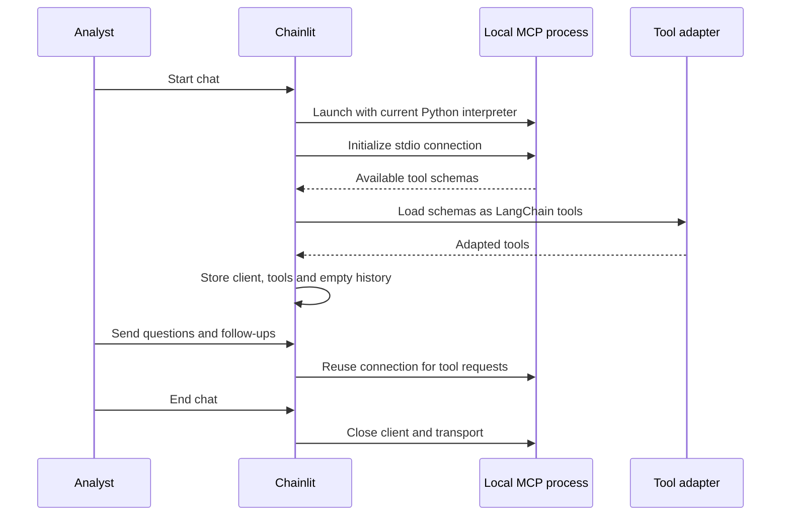
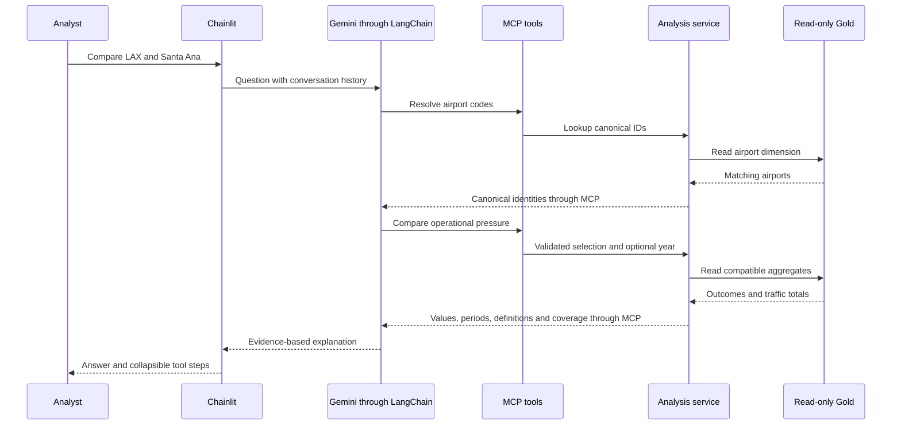
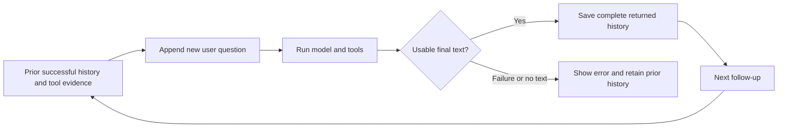
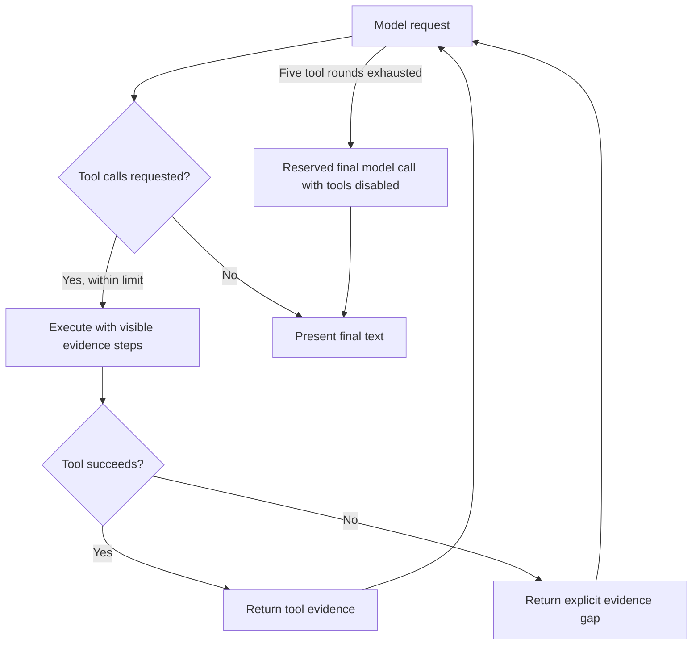

# Chat and MCP integration

The conversation layer turns analyst questions into calls to deterministic airport
tools and explains the returned evidence. Chainlit owns the chat session, LangChain
runs Gemini's model/tool loop, and FastMCP exposes the existing analysis service
through a local stdio subprocess.

## Startup and session ownership

The launcher installs pinned dependencies, sets the application import path and
starts Chainlit. The environment supplies `GEMINI_API_KEY`; optional `LLM_MODEL`
selects an available model. A prepared Gold database must already exist. Starting
chat does not run ETL.

One MCP client/process belongs to a chat, rather than a message. Application shutdown
also closes active clients. If initialization fails, the app closes the attempted
connection and asks the user to restart the chat. Session history is in memory;
login and persisted conversations are not configured.

## Tool contract

The adapter discovers schemas from the running MCP session. This avoids separately
maintaining handwritten model declarations that could diverge from server inputs.
The current LangChain integration supersedes the earlier direct Google SDK loop.

| Tool | When used | Important boundary |
|---|---|---|
| `lookup_airports` | Resolve named airports or codes to canonical IDs | Supplied state/code/name filters combine with AND |
| `traffic_growth` | Compare historical outbound passengers | Actual calendar endpoints and coverage accompany values |
| `airport_operational_pressure` | Compare arrival disruption, delays, cancellations and traffic | Operational pressure does not establish terminal congestion |
| `outbound_long_haul_share` | Measure outbound departures at least 2,000 miles | Scheduled passenger service; departure-weighted |
| `demand_capacity_pressure` | Compare passenger/seat growth with operational and forecast context | Paired records; no direct unmet-demand estimate |
| `terminal_expansion_opportunity` | Screen requested candidates against national peers | Screening points and national ranks, not investment returns |

Metric wrappers fix the metric name and forward arguments to the service. They do
not duplicate formulas. Selection is exactly one of canonical IDs, state or region.
State and region searches go directly to the analysis tool, avoiding model-created
partial airport lists. Named airports use lookup first. Arbitrary SQL is not an
exposed tool.

## One complete question

Middleware displays each tool's arguments and returned evidence in a collapsible
step. The final explanation should state the actual periods, original datasets,
metric meanings and material limitations. A number alone is insufficient: mean
positive arrival delay must retain its observed-completed-arrival denominator.

## Follow-ups and evidence history

The stored history includes user, model and tool messages. A follow-up therefore
has access to prior identities, periods, candidate lists and evidence. Prompt
instructions ask the model to preserve these settings unless the user changes them.
This retention is conversational behavior, not a separate deterministic state
machine that guarantees every follow-up will preserve its settings.

History is saved after a successful response with text. Authentication, provider,
transport or empty-response failures show an error without replacing the prior
successful history. Error messages are removed from Chainlit's chat context.

## Bounded execution and failures

The integration permits five tool rounds and reserves a sixth model call for a
summary with tools disabled. If that call still attempts a tool, a limit message
is returned. Individual tool requests have a 120-second timeout; model requests
have a 60-second timeout and one configured retry. MCP initialization has a
30-second client timeout.

Tool failures become error evidence so successful sibling results can still
support a partial answer. Model authentication, permissions, quota, unavailable
model, high demand and transport failures have user-facing error paths. Failures
do not authorize fabricated values. These controls bound execution but do not
certify factual precision in the model's explanation.

See [testing and evaluation](../06-testing-and-evaluation/testing-and-evaluation.md)
for lifecycle checks, real-process smoke checks and live-answer findings.
