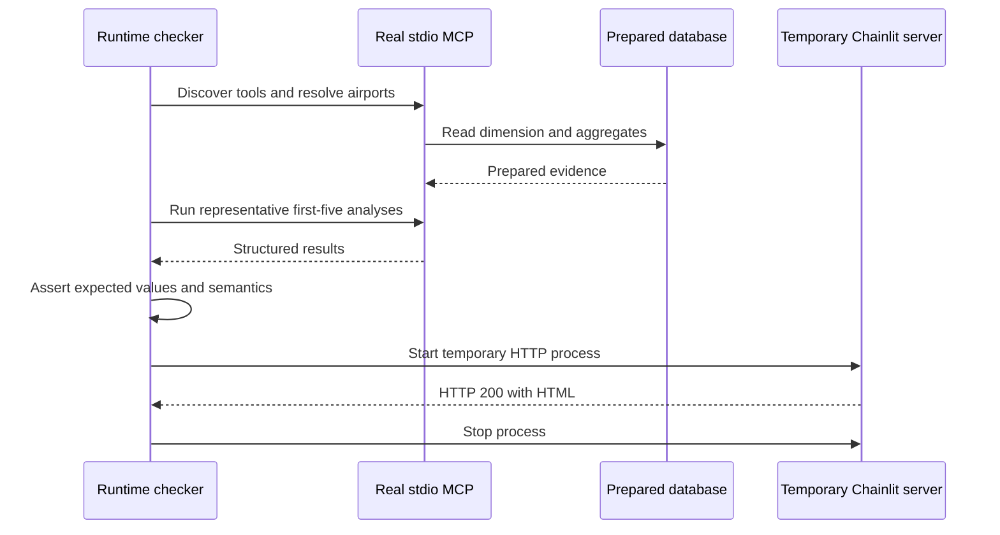
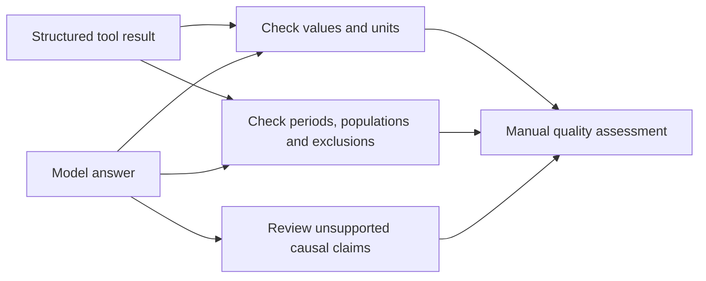

# Testing and evaluation

The project checks three distinct questions: whether deterministic calculations and
application behavior are correct, whether the real local runtime connects, and
whether model-generated explanations faithfully represent the evidence. Passing
one layer does not establish the others.

## Automated coverage by process

| Process | What the checks establish | What they do not establish |
|---|---|---|
| Activity preparation | Parsing, flags, preserved codes, duplicate keys and output behavior | Truth of every source observation |
| Performance preparation | Dates/times/statuses, partition handling and duplicate detection | Coverage of every airline or all airport activity |
| Airport reconciliation | Mapping rules, lookup coverage, aliases and conflicting identities | That future reference changes need no review |
| Outlook preparation | Source joins, missingness, keys, mapping coverage and publication failures | Forecast accuracy |
| Gold construction | Canonical aggregation, populations, evidence and non-overwrite behavior | Complete lineage to raw input hashes |
| Metric formulas | Arithmetic, denominator boundaries and invalid inputs | Whether a proxy proves a business or causal conclusion |
| Analysis service | Selection, period defaults, per-airport missingness, eligibility, percentiles and ties | Stability under a changed scoring policy |
| Database access | Read-only queries and error behavior | Performance on every future database size |
| MCP and chat | Tool forwarding, lifecycle, history, limits, failures and cleanup | Correct prose from a live model |

Small constructed examples make weighting errors visible: summing compatible
numerators/denominators must differ from averaging row percentages. Missingness
cases ensure an unavailable measurement does not become zero. Ranking cases check
that filtering geography does not redefine the national cohort.

## Checks run for this documentation revision

The following commands were run against the working tree on **2026-10-23**:

| Check | Result |
|---|---|
| `.venv/Scripts/python.exe -m pytest -q` | **294 tests passed; 10 subtests passed**, 71.65 seconds |
| `.venv/Scripts/python.exe -m ruff check app tests run_app.py` | **Passed** |
| Mermaid syntax parsing | **All 28 diagrams passed** using Mermaid 11.4.1 |
| Documentation structure and navigation | **Passed**: balanced code fences, no broken local links, all 30 question rows preserved, and no archive or implementation links in active docs |

The test run reported two dependency deprecation warnings, from Traceloop's
Pydantic configuration and Authlib's JOSE import. These were warnings rather than
failures. No fresh live model evaluation, raw-data rebuild or browser interaction
was performed for the documentation rewrite.

Diagram checks establish valid Mermaid syntax; they do not replace visual review
in the reader's Markdown renderer.

Earlier evaluation reports described full-suite collection failures caused by
obsolete Gold tests importing a removed implementation. That is a historical
finding: the current default suite passes, so those older failures must not be
presented as a current blocker.

## Real runtime smoke checks

A separate runtime checker launches the actual stdio MCP process, discovers the six
tools, resolves named airports and runs representative analyses against the local
Gold database. It then starts a temporary Chainlit HTTP server, checks for an HTML
response and stops the process. No model request is required.

A saved smoke result dated **2026-10-23, 13:01 UTC** records six-tool discovery,
passing first-five MCP checks and HTTP 200 with HTML. It is prior evidence, not a
new smoke run performed during this rewrite. The snapshot's reference checks were:

| Case | Saved expectation and meaning |
|---|---|
| New England screening | PVD leads; returned forecast edition is 2025 |
| LAX operational comparison | Mean positive arrival delay rounds to 14.04 minutes, using observed completed arrivals |
| Anchorage long haul | Share rounds to 14.36% for scheduled outbound passenger departures |
| SFO pressure | Paired measurements remain partial; growth gap rounds to -1.23 percentage points |
| Texas growth search | All 70 selected IDs remain accounted for; eligible positive-growth list is ABI, VCT, SJT, SPS and CRP |

These values describe the saved data snapshot, not permanent airport facts. The
checker contains snapshot-specific expectations. A changed source/database needs
an independently justified new reference baseline. HTTP startup proves serving,
not browser interaction or a successful analyst chat.

## Live-answer evaluation

The live evaluator calls the production agent and real MCP tools with a fresh
history for each standalone question. It saves model/prompt configuration, tool
schemas, traces, answers and regression flags. The first five cases cover regional
screening, an operational comparison, long-haul share, SFO demand indicators and a
state-wide growth search.

The saved **2026-10-23 stability evaluation** used one generation per question with
`gemini-3.5-flash-lite`. It bypassed the browser and compared prose to returned tool
evidence rather than independently recomputing every result from raw sources.
Its findings remain useful but do not certify the currently configured model.

| Case | Historical finding | Practical implication |
|---|---|---|
| Expansion screening | Correct ranking table and PVD lead, but contradictory boarding-growth prose and one fiscal/calendar label error | Review narrative claims even when the table is correct |
| Operational comparison | Core figures and denominator were correct; an exact-phrase flag was overly strict | Regression flags need semantic review |
| Long-haul share | Correct percentage, counts, period, threshold and service scope | This case passed in that observed run |
| SFO indicators | Omitted partial coverage and introduced unsupported scheduling/ATC explanations | Unattended analytical precision was not established |
| Texas growth | Correct state-wide request and eligible candidate list | Earlier truncation/geography failure was resolved in that run |

Earlier first-five runs also exposed score-versus-percentile confusion, an incorrect
delay denominator, and a Texas search narrowed to 25 of 70 airports before changing
the geography. Subsequent changes moved state selection, default-period handling,
metric definitions and candidate summaries into deterministic service output.
The later run improved those cases, while interpretation errors remained.

Regex checks are fast warning signals, not correctness certificates. They can miss
contradictions within an answer or flag an acceptable paraphrase. Human review
must examine numerator/denominator meanings, forecast units, omitted coverage and
claims beyond the evidence.

## Broader question catalog

The [30-question catalog](../01-overview/test-set.md) is a set of desired analytical
scenarios, not a claim of 30 supported tools or completed reference answers.
Questions 20–29 form five independent two-turn conversations. Their follow-ups
must preserve candidates, periods and definitions unless explicitly changed.

The saved live evaluation covers only the first five standalone questions. It does
not establish repeated-run reliability, complete follow-up coverage, peer matching,
seasonality, cargo-inclusive comparisons or route-removal analysis. Some scenarios
need new deterministic operations and definitions before they can be accepted.

## Reproducing checks without confusing their scope

From the repository root, automated tests and lint use the commands above. They do
not require live-model prose to pass. The maintained runtime and live-evaluation
runners are separate tools; a runtime smoke check reads the prepared database,
while a live run makes billable provider requests and depends on quota.

The runtime checker currently writes to a fixed historical evidence directory.
Preserve existing evidence before running it; it has no output-directory option.
The live evaluator requires an explicit output directory and refuses to reuse one
containing its configuration file. For a new live study, capture configuration,
freeze the database and metric definitions, run multiple generations per case and
review complete evidence alongside automated flags.

The present conclusion is narrow: the automated suite and lint pass. Prior runtime
checks show successful local connections. Historical live answers still demonstrate
interpretation errors, so numerical correctness and explanation quality must
continue to be assessed separately.
